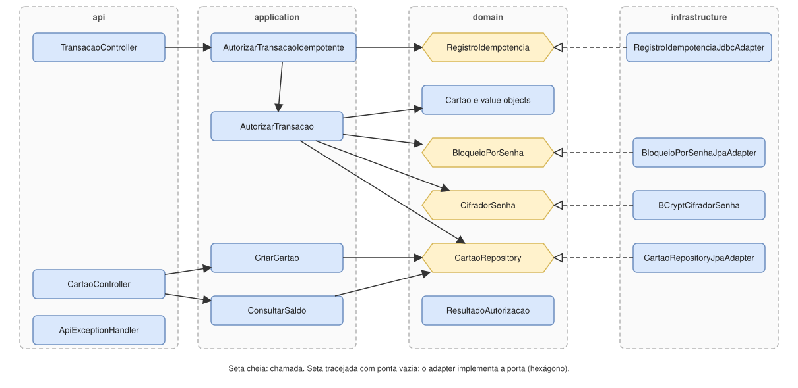

# 01 - Visão geral

O projeto segue arquitetura hexagonal (portas e adaptadores) com os padrões táticos do DDD. A ideia central é que as regras de negócio não conhecem o framework: elas definem as **portas** de que precisam, e a infraestrutura as implementa.

## Camadas e dependências

As setas cheias são chamadas; as tracejadas são implementações de uma porta (os hexágonos). Tudo aponta para o domínio: `api` chama `application`, `application` usa o `domain`, e a `infrastructure` implementa as portas que o `domain` declara. Quem liga as peças é `CasosDeUsoConfig`, na infraestrutura.

**A regra de dependência**, conferida no código atual:

- `domain` e `application` não importam Spring, Jakarta nem Jackson, e não importam `api` nem `infrastructure`;
- `api` não importa `infrastructure`.

Hoje essa regra é mantida por convenção e conferida por busca de imports. Não há um teste automático que a proteja; um teste de arquitetura (por exemplo, com ArchUnit) seria o próximo passo.

## O que fica em cada pacote

| Pacote | Responsabilidade | Classes principais |
|---|---|---|
| `domain/cartao` | O agregado e suas regras | `Cartao`, `NumeroCartao`, `SenhaCifrada`, `PoliticaDeBloqueio`; portas `CartaoRepository`, `BloqueioPorSenha`, `CifradorSenha`; `SemBloqueioPorSenha` |
| `domain/transacao` | O desfecho de uma autorização | `ResultadoAutorizacao` (selado: `Autorizada` ou `Recusada`), `MotivoRecusa`; `ChaveIdempotencia` e a porta `RegistroIdempotencia` |
| `domain/compartilhado` | Conceitos usados por mais de um agregado | `Dinheiro`, `ValorInvalidoException` |
| `application` | Um caso de uso por classe, sem anotações do Spring | `CriarCartao`, `ConsultarSaldo`, `AutorizarTransacao`, `AutorizarTransacaoIdempotente` |
| `infrastructure/persistence` | Persistência com JPA e MySQL | `CartaoEntity`, `CartaoMapper`, `CartaoJpaRepository`, `CartaoRepositoryJpaAdapter`, `BloqueioPorSenhaJpaAdapter`, `RegistroIdempotenciaJdbcAdapter`, `LimpezaIdempotencia` |
| `infrastructure/seguranca` | Cifragem de senha | `BCryptCifradorSenha` |
| `infrastructure/config` | Ligação das peças, segurança e JSON | `CasosDeUsoConfig`, `SegurancaConfig`, `JacksonConfig`, `AgendamentoConfig`, `LogsConfig` |
| `api/controller` | Tradução entre HTTP e os casos de uso | `CartaoController`, `TransacaoController` |
| `api/dto` | Corpos de requisição | `NovoCartaoRequest`, `TransacaoRequest` |
| `api` | Tradução das exceções de entrada para HTTP | `ApiExceptionHandler` |
| `resources/db/migration` | Esquema do banco | `V1__cria_tabela_cartao.sql`, `V2__adiciona_bloqueio_por_senha.sql`, `V3__cria_tabela_transacao_idempotente.sql` |

## Como o domínio é modelado

- **`Cartao` é o agregado.** Só se obtém por duas fábricas: `criar` aplica o saldo inicial de R$ 500,00 e `reconstituir` monta o cartão a partir do banco sem reaplicar regras de criação. As regras que dependem só do estado do cartão estão nele: `conferirSenha` e `verificarSaldo`.
- **Value objects se validam na construção.** `NumeroCartao`, `Dinheiro` e `SenhaCifrada` são imutáveis, então um valor inválido não chega a existir. `NumeroCartao` e `SenhaCifrada` mascaram o próprio `toString`, para não vazar o número nem o hash da senha em log.
- **O modelo de persistência é separado.** `CartaoEntity` é o modelo JPA e `CartaoMapper` traduz entre ele e o agregado, para que as exigências do JPA (construtor vazio, campos mutáveis) não entrem no domínio.
- **O agregado não é dono de toda a regra.** O invariante "saldo nunca negativo" e a contagem de senhas erradas precisam ser atômicos entre instâncias, então são garantidos por uma instrução SQL no adapter. O agregado faz uma checagem prévia. Isso é um custo assumido; está explicado no [registro 0002](decisoes/0002-concorrencia-update-condicional.md).

## Como as peças são testadas

Os testes seguem os pacotes do código. O domínio e a aplicação são testados sem subir o Spring, com um repositório em memória e um cifrador determinístico. O adapter JPA e a concorrência são testados contra um MySQL 5.7 real, via Testcontainers. A estratégia completa está no [README da raiz](../../README.md#estratégia-de-testes).
