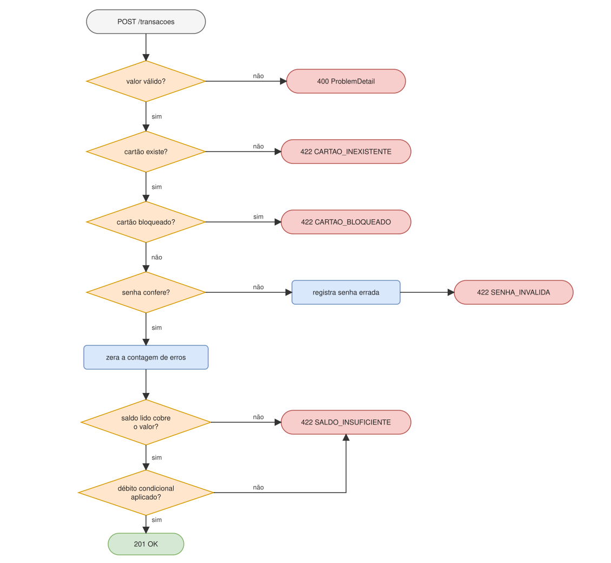
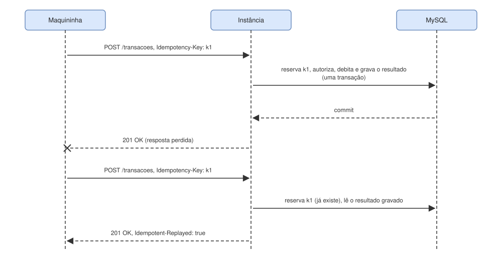
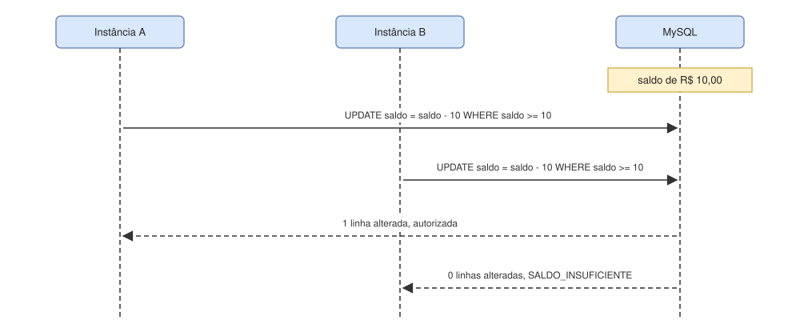

# 02 - Fluxo da transação

O caminho de `POST /transacoes`, do corpo da requisição até o `201` ou o `422`.

## As regras, em ordem



As etapas de bloqueio (cartão bloqueado, registra senha errada, zera a contagem) só fazem algo quando o bloqueio está ligado, o que não é o padrão. Desligado, `SemBloqueioPorSenha` autoriza essas etapas e nunca devolve `CARTAO_BLOQUEADO`. Veja o [registro 0004](decisoes/0004-bloqueio-por-senhas-erradas.md).

## Quem faz o quê

| Etapa | Quem executa | Se falhar | Atômico no banco |
|---|---|---|---|
| Corpo válido | Bean Validation em `TransacaoRequest` | 400, com o campo que falhou no `detail` | não |
| Valor positivo, até 2 casas e 17 dígitos inteiros | `Dinheiro.positivo` | 400 (`ValorInvalidoException`, traduzida por `ApiExceptionHandler`) | não |
| Cartão existe | `NumeroCartao.tentar` e `CartaoRepository.buscar` | `CARTAO_INEXISTENTE` | não |
| Cartão não bloqueado | `BloqueioPorSenha.verificarDesbloqueado` | `CARTAO_BLOQUEADO` | leitura |
| Senha confere | `Cartao.conferirSenha` | `SENHA_INVALIDA`, e `registrarSenhaErrada` soma o erro | `UPDATE` |
| Zera a contagem | `BloqueioPorSenha.registrarSenhaCerta` | `CARTAO_BLOQUEADO`, se erros simultâneos bloquearam o cartão no meio do caminho | `UPDATE` |
| Saldo lido cobre o valor | `Cartao.verificarSaldo` | `SALDO_INSUFICIENTE` | não |
| Débito | `CartaoRepository.debitar` | `SALDO_INSUFICIENTE` | `UPDATE` condicional |

Um número de cartão em formato inválido não é um erro: `NumeroCartao.tentar` devolve vazio, e o resultado é `CARTAO_INEXISTENTE`, porque um número assim não pode corresponder a nenhum cartão cadastrado.

## Como a cadeia é montada

`AutorizarTransacao` encadeia as etapas com `ResultadoAutorizacao.entao`. Cada etapa devolve `Autorizada` ou `Recusada(motivo)`. `Autorizada.entao` executa a próxima etapa; `Recusada.entao` devolve a própria recusa sem executar nada. Por isso a primeira recusa encerra a cadeia, e a ordem das regras é a ordem em que elas aparecem no código. `seRecusada` executa um efeito só numa recusa, sem interromper a cadeia, e é assim que uma senha errada é contada. Veja o [registro 0003](decisoes/0003-recusa-como-resultado.md).

## Reenvio com `Idempotency-Key`

Se a requisição traz o cabeçalho `Idempotency-Key`, `AutorizarTransacaoIdempotente` envolve toda a cadeia acima na porta `RegistroIdempotencia`. A chave é reservada, a autorização roda e o resultado é gravado, tudo na mesma transação do banco. Um reenvio com a mesma chave e a mesma requisição não executa nenhuma regra: devolve o status e o corpo da primeira resposta, com `Idempotent-Replayed: true`. A mesma chave em outra requisição vira `422`, e uma chave fora do formato vira `400`. Sem o cabeçalho, o fluxo é o descrito acima. Veja o [registro 0008](decisoes/0008-idempotencia-por-cabecalho.md).



## Como o resultado vira HTTP

`TransacaoController` traduz o resultado com `switch` sobre tipos selados, sem `default`: primeiro `Nova` ou `Repetida` (a repetida leva o cabeçalho `Idempotent-Replayed`), depois `Autorizada`, que vira `201` com o texto `OK`, ou `Recusada`, que vira `422` com o nome do motivo no corpo. Se alguém criar um terceiro desfecho, o código deixa de compilar até ele ter uma resposta definida.

Recusar uma transação não é uma falha, então não passa pelo tratamento de exceções. Entrada inválida (valor fora das regras, JSON malformado, campo ausente) é que vira `400` em formato `ProblemDetail`; credenciais erradas viram `401`, pelo Spring Security.

## Concorrência entre instâncias

O débito não lê o saldo, subtrai e grava. Ele é uma instrução só, e o banco decide:

```sql
UPDATE cartao SET saldo = saldo - :valor WHERE numero = :numero AND saldo >= :valor
```



O MySQL serializa os dois updates na linha do cartão. O primeiro encontra saldo suficiente e altera uma linha; o segundo já vê o saldo zerado e altera zero. O resultado é decidido pelo número de linhas alteradas, sem lock em memória (que não valeria entre instâncias) e sem laço de nova tentativa. A escolha e as alternativas estão no [registro 0002](decisoes/0002-concorrencia-update-condicional.md).
